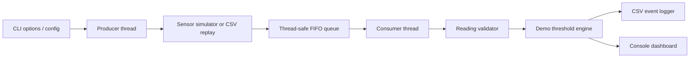

<div align="center">

# VitalWatch

### A C++17 Multithreaded Monitoring & Fault Detection Simulator

**Producer–consumer concurrency · Synthetic sensor data · Fault classification · Deterministic replay · Automated testing**


[Quick Start](#quick-start) · [How It Works](#how-it-works) · [Evidence](#verified-results) · [Architecture](docs/ARCHITECTURE.md) · [Interview Guide](docs/INTERVIEW.md)

</div>

> [!IMPORTANT]
> **Educational software only.** VitalWatch processes **synthetic** readings, not real patient information. Its thresholds are non-clinical demonstration rules. It is **not a medical device**, was not clinically validated, and is not affiliated with Philips or any healthcare manufacturer.

## Overview

VitalWatch is a compact, modular C++17 console application that simulates three sensor channels—**heart rate**, **oxygen saturation (SpO₂)**, and **temperature**—and processes their readings using a producer–consumer pipeline. Its purpose is to make core software engineering concepts visible and testable: thread synchronization, error handling, input validation, file I/O, deterministic debugging, and component-level testing.

Unlike a UI-only demonstration, VitalWatch includes executable test cases and checked-in build and runtime evidence. The project does **not** require real sensors, third-party runtime libraries, a database, or cloud credentials.

### What you can demonstrate

- **Multithreading:** a producer generates/replays samples while a consumer validates, classifies, and logs them.
- **Safe coordination:** a `std::mutex`-protected FIFO queue uses `std::condition_variable` to wait without busy polling and supports graceful close/drain.
- **Fault distinction:** readings are labelled **missing**, **invalid**, **disconnected**, or a **demo threshold alert**, rather than treating every issue as a single alarm.
- **Reproducibility:** fixed deterministic inputs and strict CSV replay make failures straightforward to reproduce.
- **Observable output:** a console table plus `readings.csv` and `events.csv` records what happened.
- **Failure handling:** injected producer/consumer exceptions and malformed inputs are covered by tests.

## Verified results

These results come from the project's **recorded Linux/GCC verification session on 2026-10-15**; see the evidence files for exact output. They are not claims of native Windows execution or production performance.

| Verification | Observed result | Evidence |
| --- | --- | --- |
| Automated checks | **23 / 23 CTest cases passed** in Release, 0 failed | [`evidence/ctest-release.txt`](evidence/ctest-release.txt) |
| Producer–consumer FIFO | **1,000 samples** processed once and in order in the `shutdown` test | [`tests/tests.cpp`](tests/tests.cpp), [`docs/VERIFICATION.md`](docs/VERIFICATION.md) |
| Deterministic console demo | **8 readings**, **6 emitted events** | [`evidence/demo-console.txt`](evidence/demo-console.txt), [`evidence/demo-events.csv`](evidence/demo-events.csv) |
| Sample replay | Recorded output matched the deterministic demo in verification | [`docs/VERIFICATION.md`](docs/VERIFICATION.md) |
| Malformed replay input | Rejected with non-zero exit and line-number diagnostic | [`evidence/malformed-input.txt`](evidence/malformed-input.txt) |
| SIGINT interruption | Recorded Linux run exited cleanly after processing 4 accepted samples | [`evidence/sigint-console.txt`](evidence/sigint-console.txt) |

**Environment:** Linux x86-64 · GCC 13.3.0 · CMake/CTest 3.28.3 · C++17. Native Windows/MSVC verification is still pending. No hardware, real patient data, clinical accuracy, thread throughput, or performance benchmarking is claimed.

## Tech stack

| Area | Technologies / design |
| --- | --- |
| Language | **C++17**, Standard Template Library (STL) |
| Concurrency | `std::thread`, `std::mutex`, `std::condition_variable`, `std::atomic` |
| Data structures | `std::queue`, `std::vector`, `std::optional` |
| Build & test | **CMake**, **CTest**, GCC/Linux verification; MSVC configuration supported but unverified |
| Inputs | Synthetic generator, configurable thresholds, strict CSV replay |
| Outputs | Console report, timestamped readings/events in CSV |

## Architecture



The producer and consumer have separate responsibilities. The queue guards shared state with a mutex and uses a condition variable to wake the consumer when new data arrives or the queue closes. The processing path validates input **before** applying demo alert rules, so disconnected or invalid values are not interpreted as threshold events.

For component ownership, error propagation, shutdown semantics, requirements traceability, and design trade-offs, read **[docs/ARCHITECTURE.md](docs/ARCHITECTURE.md)**.

## Quick start

### Option A — Linux (verified toolchain family)

**Prerequisites:** a C++17 compiler (GCC 9+ recommended), CMake 3.16+, and Make or Ninja.

From the directory containing `CMakeLists.txt`:

```bash
cmake -S . -B build -DCMAKE_BUILD_TYPE=Release
cmake --build build --parallel
ctest --test-dir build --output-on-failure
./build/vitalwatch --deterministic --count 8 --interval-ms 0 --log-dir logs-demo
```

The final command should print a table of eight synthetic readings and write two CSV files under `logs-demo/`. To inspect them:

```bash
cat logs-demo/readings.csv
cat logs-demo/events.csv
```

### Option B — Windows 11 with Visual Studio Build Tools (instructions; not yet verified)

**Prerequisites:** Visual Studio 2022 Build Tools with **Desktop development with C++** and a Windows SDK, plus CMake 3.16+.

Run from the project folder in **PowerShell**:

```powershell
cmake -S . -B build -G "Visual Studio 17 2022" -A x64
cmake --build build --config Release --parallel
ctest --test-dir build -C Release --output-on-failure
.\build\Release\vitalwatch.exe --deterministic --count 8 --interval-ms 0 --log-dir logs-demo
Get-Content .\logs-demo\readings.csv
Get-Content .\logs-demo\events.csv
```

If Visual Studio 2022 Build Tools aren't installed, get them via the [official Microsoft instructions](https://learn.microsoft.com/en-us/cpp/overview/acquire-msvc?view=msvc-170), then install [CMake](https://cmake.org/download/). On Windows, the default generator may differ; the explicit command above assumes VS 2022. Compilation/testing on your own system is needed before claiming Windows compatibility has been verified.

> **No application login is needed.** This is a C++ console simulator, not a hosted web application or a patient dashboard.

## Sample console output

*Excerpt from the captured deterministic run (not a rendered UI screenshot):*

```text
VitalWatch | EDUCATIONAL SIMULATOR | NON-CLINICAL DEMO THRESHOLDS
HR: 60..100  SpO2: 90..100  Temp C: 36..38
UTC timestamp         HR BPM   SpO2 %   Temp C   Sensor/event status
2026-01-01T00:00:00Z     75.0     97.0     37.0  CONNECTED
2026-01-01T00:00:01Z    120.0     97.0     37.0  CONNECTED | DEMO_ALERT:heart_rate
2026-01-01T00:00:02Z     75.0     85.0     37.0  CONNECTED | DEMO_ALERT:oxygen
2026-01-01T00:00:04Z     -5.0     97.0     37.0  CONNECTED | INVALID:heart_rate
2026-01-01T00:00:05Z     75.0       --     37.0  CONNECTED | MISSING:oxygen
2026-01-01T00:00:06Z       --       --       --  DISCONNECTED | DISCONNECTED:unit
Processed 8 readings. Logs: logs-demo
```

Read the entire real output: [`evidence/demo-console.txt`](evidence/demo-console.txt).

## How it works

1. **Read options and inputs.** `main.cpp` validates CLI options, optional configuration, and replay files before worker startup.
2. **Generate or replay data.** The producer emits synthetic readings or a prepared sequence of CSV rows.
3. **Transfer safely.** A thread-safe FIFO queue transfers each accepted reading to the consumer.
4. **Validate and classify.** `ReadingValidator` distinguishes disconnection, missing, and invalid values; `AlertEngine` checks valid values against configurable **demo** intervals.
5. **Record evidence.** `EventLogger` writes readings and emitted events to CSV and the program prints a console status row.
6. **Shut down safely.** On normal completion or a producer stop, the queue closes, pending accepted items drain, and threads join. Consumer failure closes the queue and surfaces an error rather than promising data retention.

### Default demonstration intervals (not clinical guidance)

| Synthetic channel | Input domain | Demonstration interval |
| --- | --- | --- |
| Heart rate | 0–300 BPM | 60–100 BPM |
| SpO₂ | 0–100% | 90–100% |
| Temperature | 20–50 °C | 36–38 °C |

The bounds are inclusive. Adjust alert rules using [`data/demo_thresholds.cfg`](data/demo_thresholds.cfg). Invalid configuration keys/values are rejected; the parser does not accept arbitrary inline comments.

## Useful CLI scenarios

| Goal | Command (Linux path shown) |
| --- | --- |
| Reproducible eight-sample demo | `./build/vitalwatch --deterministic --count 8 --interval-ms 0 --log-dir logs-demo` |
| Seeded synthetic samples | `./build/vitalwatch --seed 7 --count 16 --log-dir logs-seeded` |
| Replay supplied CSV and configuration | `./build/vitalwatch --replay data/sample_replay.csv --config data/demo_thresholds.cfg --interval-ms 0 --log-dir logs-replay` |
| Verify malformed input handling | `./build/vitalwatch --replay data/malformed_replay.csv` (expected non-zero exit) |
| List all available options | `./build/vitalwatch --help` |

On Windows, replace `./build/vitalwatch` with `.\build\Release\vitalwatch.exe`. Every run **overwrites** both output CSVs within the chosen log directory. Use distinct `--log-dir` values when you need to preserve previous runs. The output CSV schema is not the same as the replay input schema.

## Testing and reproducibility

The CMake configuration registers **20 component/integration tests plus 3 CLI checks**. Tests cover sensor input boundaries, missing/disconnected values, rule configuration, strict CSV parsing, FIFO close/drain, worker exceptions, and CLI error paths.

```bash
ctest --test-dir build --output-on-failure
```

For a focused test:

```bash
ctest --test-dir build -R "^(shutdown|producer_error|consumer_error)$" --output-on-failure
```

The suite uses throwing checks that still run in Release. The recorded Linux build also used `-Wall -Wextra -Wpedantic -Werror`. The badge above refers to **that recorded verification**, not to a live GitHub Actions job. GitHub Actions CI is **not included in this source package**.

More detail: [Testing & debugging](docs/TESTING.md) · [Verification report](docs/VERIFICATION.md) · [Raw CTest evidence](evidence/ctest-release.txt).

## Project structure

```text
VitalWatch/
├── CMakeLists.txt             # C++17 build and CTest registration
├── README.md                  # You are here
├── include/vitalwatch/        # Core component interfaces and types
├── src/                      # C++ implementation and CLI entry point
├── tests/tests.cpp           # Unit/integration/CLI support checks
├── data/                     # Synthetic replay and demo rule fixtures
├── evidence/                 # Captured build, test, console and CSV evidence
└── docs/
    ├── ARCHITECTURE.md       # Architecture, requirements and SDLC
    ├── TESTING.md            # Test strategy and debugging guidance
    ├── VERIFICATION.md       # Exact observed metrics and limitations
    ├── INTERVIEW.md          # Interview explanations and Q&A
    ├── DEMO_GUIDE.md         # Short recruiter-friendly demo
    └── GITHUB_PUBLISHING.md  # Safe upload instructions for Windows
```

## Design decisions & trade-offs

- **C++17 and the STL** demonstrate standard threads, data ownership and low-level synchronization without external runtime packages. This is a learning and software-design choice, **not a performance superiority claim**.
- **One consumer writes logs** to avoid concurrent file-stream writes; CSV prioritizes traceability over persistence/performance.
- **Strict replay parsing** favors reproducibility but intentionally supports a narrow CSV format (unquoted, five fields).
- **Unbounded queue and preloaded replay** keep the MVP easy to understand; backpressure and streaming large datasets are future work.
- **Deterministic tests** verify exercised scenarios, not every possible thread interleaving or guaranteed hard real-time behavior.

## Limitations and responsible use

- No real sensors or patient data; no clinical, medical-device, safety, certification, or standards claims.
- No GUI/web portal, hardware firmware, cloud deployment, live CI pipeline, or throughput benchmark.
- Windows/MSVC build and Windows Ctrl+C behavior remain **unverified**.
- No alarm persistence/acknowledgement, timed missing-data watchdog, per-channel link states, or bounded-queue backpressure.
- Logs are for local demonstrations; they are not a secure clinical audit trail. Forced process termination can interrupt output.

These limitations are intentional and discussed further in [architecture documentation](docs/ARCHITECTURE.md).

## Documentation

| Document | What you'll find |
| --- | --- |
| [Architecture](docs/ARCHITECTURE.md) | System diagram, module responsibilities, thread ownership, SDLC and trade-offs |
| [Testing](docs/TESTING.md) | Tests, debugging cases and Windows validation checklist |
| [Verification](docs/VERIFICATION.md) | Observed results, supporting evidence and what remains untested |
| [Interview preparation](docs/INTERVIEW.md) | Short project pitch, key decisions, 15 likely technical questions and suggested resume bullets |
| [5-minute demo](docs/DEMO_GUIDE.md) | Concise demo steps for reviewers and placement interviews |
| [GitHub publishing](docs/GITHUB_PUBLISHING.md) | Safe Windows upload steps and updating an already staged README |

## Roadmap (not yet implemented)

- [ ] Verify build/tests on native Windows/MSVC; capture new evidence.
- [ ] Add GitHub Actions CI for Linux and Windows builds after local verification.
- [ ] Add a bounded queue and explicit backpressure policy.
- [ ] Support timeout-based missing-data detection and log rotation.
- [ ] Improve independent per-channel connection states.

## License and project status

**License:** No license is included in the supplied project. The repository should not claim MIT, Apache-2.0, or any other license until the owner explicitly selects one. Public GitHub visibility does **not** by itself grant reuse or redistribution rights.

**Author:** [Mohammad Yusuf K A](https://github.com/yusufthecoder474) · Educational portfolio project · Source snapshot with recorded verification on 2026-10-15.
