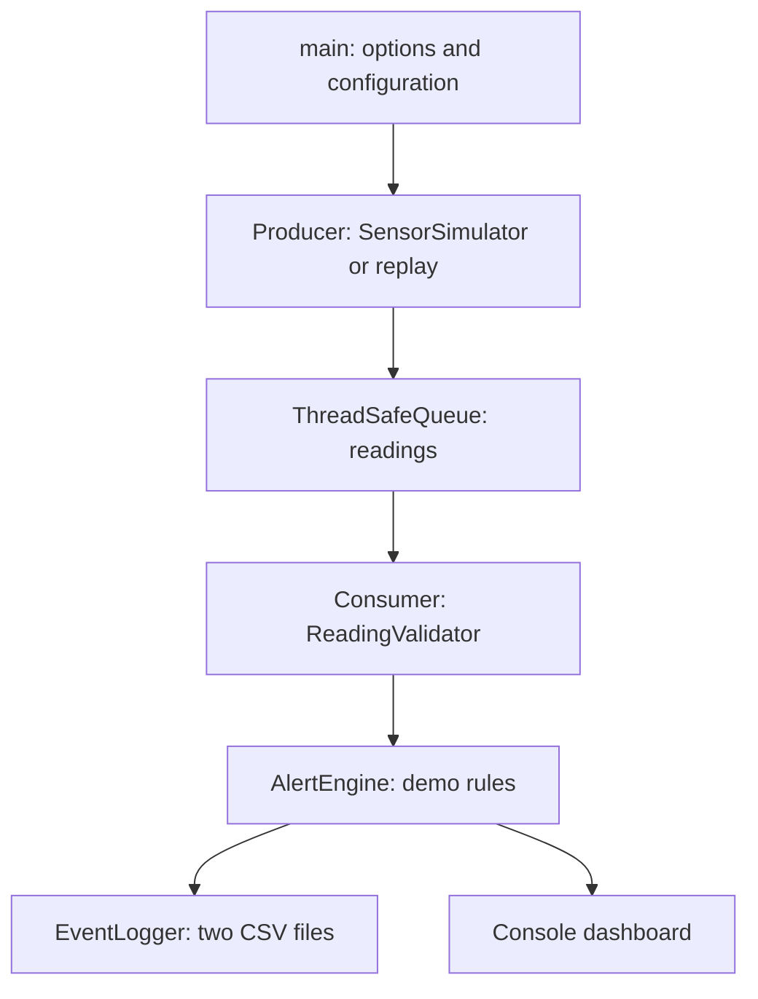

# Requirements, architecture and SDLC

Current concurrency/DSA details and ordering limits are in [CONCURRENCY.md](CONCURRENCY.md); current test counts, added build automation and diagnostic outcomes are in [THALES_VERIFICATION.md](THALES_VERIFICATION.md). The implementation retains the same acquisition/queue/processing architecture.

## Problem statement

Monitoring software must distinguish usable data from sensor faults before applying rules. VitalWatch demonstrates that separation using only synthetic values and a small console program. The user's need is a repeatable, explainable portfolio demonstration with readable errors and inspectable logs, achievable within a 6–8 hour study window.

## Software requirements and traceability

| ID | Requirement / acceptance criterion | Verification cases |
| --- | --- | --- |
| R1 | Simulate three channels; repeat the scenario deterministically | `deterministic`, `cli_demo` |
| R2 | Console table includes timestamp, units, values and status | `cli_demo`; manual captured dashboard in evidence/demo-console.txt |
| R3 | Separate valid data, invalid domains, missing values and disconnected unit | `valid`, `invalid_hr`, `invalid_oxygen`, `invalid_temperature`, `missing`, `disconnected`, `nonfinite` |
| R4 | Apply configurable non-clinical intervals only to usable data | `threshold`, `boundaries`, `config`, `config_invalid` |
| R5 | Producer and consumer exchange FIFO samples and terminate safely | `shutdown`, `queue_close`, `producer_error`, `consumer_error` |
| R6 | Write timestamped sample/event CSV with escaped strings | `csv`, `cli_demo`; captured demo CSVs |
| R7 | Reject malformed/missing replay and configuration files | `malformed`, `missing_file`, `config_invalid`, `replay` |
| R8 | Report invalid CLI input with nonzero exit | `cli_invalid`, `cli_missing_argument` |
| R9 | C++17, STL, portable CMake build, no third-party runtime libraries | Actual compiler/build evidence; native MSVC run still pending |
| R10 | Checks stay enabled in Release | Throwing `require` checks; Release CTest execution |
| R11 | SIGINT stops acquisition and drains accepted samples | Linux signal_shutdown CTest check; native Windows behavior pending |

## High-level design

The arrows inside the consumer represent processing order. The validator and alert engine are independent reusable components: both enforce usable-data rules, so the alert engine remains safe if called directly. `Types.h` carries the small shared value objects. `Replay` is an input adapter; `Pipeline` integrates callbacks and owns thread lifetime. These two helpers avoid mixing CSV parsing and thread lifecycle into the six main requested components.

## Component responsibilities

| Component | Responsibility | Ownership |
| --- | --- | --- |
| SensorSimulator | Seeded baseline, fixed fault schedule, synthetic timestamps | Producer only |
| ThreadSafeQueue | Mutex-protected `std::queue`, wait predicate, close/drain | Both workers |
| ReadingValidator | Domain, missing and connection checks | Consumer only; stateless |
| AlertEngine | Validate configuration and apply inclusive demo rules | Consumer only after setup |
| EventLogger | Create directory, serialize CSV and surface I/O errors | Consumer writes; main constructs |
| Replay | Validate CSV syntax and build `vector<Reading>` | Main loads; producer reads |
| Pipeline | Launch, join, close and propagate worker errors | Main controls lifecycle |
| main | CLI, stop flag, component integration and table | Coordinates ownership |

## Threads and OS fundamentals

The producer and consumer are separate execution flows inside one process and share its memory. The producer invokes `next()` inside its worker, then pushes a value copy. The consumer blocks on a condition variable until a sample arrives or the queue closes. This avoids a busy waiting loop.

The queue's mutex protects **both** its container and `closed_`. Every read/write of those fields holds that mutex. `wait(lock, predicate)` handles spurious wakeups and atomically releases the lock while waiting, then reacquires it before examining state. Notifications happen after changing state under the lock. A closed queue rejects pushes, but still returns any accepted samples before `pop()` reports completion.

Only the producer mutates its simulator and index; only the consumer writes files, prints rows and increments `processed`. Main reads final state only after `join()` establishes completion. Each worker owns its separate exception pointer; main reads those after joining. SIGINT uses an explicitly lock-free atomic boolean so the handler needs no mutex or I/O.

Normal/producer-error shutdown closes and drains the queue. Consumer failure closes the queue to reject later pushes; remaining samples may be dropped because processing failed. Its error is rethrown after joins and main returns 1. If producer thread construction fails, the already-started consumer is closed and joined. No worker is detached, and no queue lock is held while formatting, writing, or sleeping.

## Development approach / SDLC

1. **Requirements:** Define synthetic channels, four event categories, demo intervals, finite runs and error expectations.
2. **Design:** Use a small core library, two workers, value-object messages and single-owner file streams.
3. **Implementation:** Build the simulator, validation, rules and CSV components, then integrate with the closeable queue and CLI.
4. **Verification:** Compile with warnings, run independent Release CTest cases, replay the sample and inspect end-to-end output. Record exact results, including what could not be tested.
5. **Investigation:** Use compiler diagnostics and focused regression cases to isolate issues; see TESTING.md.
6. **Maintenance:** Update requirements, relevant tests and documentation together when changing behavior.

## Maintenance considerations

- Change demo rules through config rather than recompiling; retain configuration with any captured run.
- Keep domain checks distinct from demo thresholds and update boundary tests when either changes.
- Preserve CSV schemas or version them when adding fields. Output is intentionally not an input replay format.
- Test failure paths after altering the queue, callbacks or logger. Keep file writing confined to the consumer.
- Use a fresh log directory per run; per-row flushing favors inspectability over throughput.
- Verify Windows and Linux builds after portability changes. Add a native Windows CI job if extending this project.

## Limitations

Not a medical device, clinical validation tool, real-time operating system or fault-tolerant service. No real patients/hardware, persistence guarantees, alarm acknowledgement, patient history, authentication or standards compliance. A disconnection applies to the entire simulated three-channel unit; missing data is detected per field, not by a timed watchdog. No alarm hysteresis/debouncing. A stalled operating-system file write can still delay shutdown. SIGINT shutdown depends on terminal signal delivery.

The queue is unbounded and replay is preloaded into memory. CLI-generated runs cap samples at 10,000; replay should remain small. A next step for long-running acquisition would be a bounded queue with backpressure and cancellable waits. Deterministic tests verify logic and finite scenarios; they are not proof of all possible thread schedules or absence of every race.

## Future improvements (not implemented)

Bounded queue, independent channel connection states, a timed missing-data watchdog, log rotation, native Windows CI and a small alarm acknowledgement state. Keep the current MVP as the baseline before adding these features.
