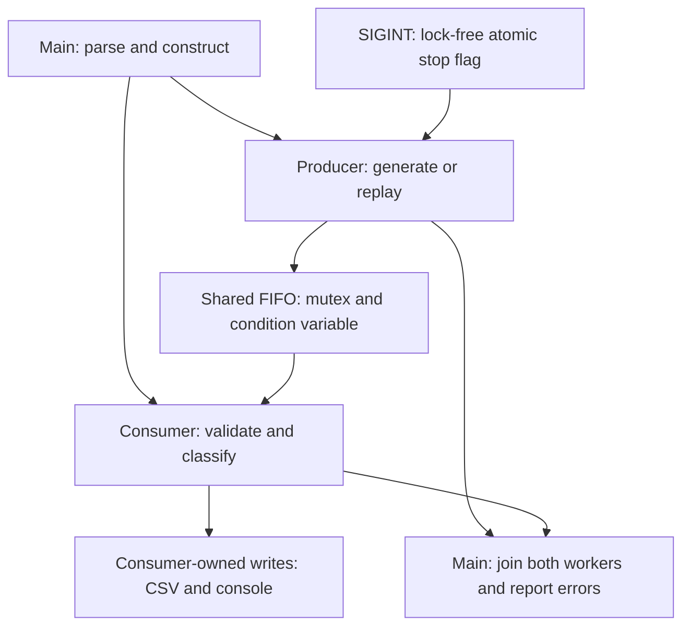

# Concurrency, data structures and ownership

Current extension: [FIRMWARE_RELIABILITY.md](FIRMWARE_RELIABILITY.md) adds optional library-level bounded capacity/backpressure. The default and CLI remain unbounded. In bounded mode push waits on a second capacity condition variable, pop notifies space, and close wakes both sides. The detailed original default-mode explanation below is retained as historical design context.

This describes the delivered code, not a proposed multi-worker architecture. The application starts **one producer and one consumer**, plus the main thread. Some tests use an extra controller task to coordinate a reproducible scenario; that is not an extra application worker.

## Actual architecture

The queue arrow represents a value transfer. Sensor generation happens inside the producer callback. Replay rows are loaded into a vector before the workers start. The consumer validates each reading, creates its event vector, writes CSV, and prints a dashboard row synchronously. There is no background logging thread.

## Queue choice and algorithmic reasoning

`ThreadSafeQueue<Reading>` wraps **std::queue**, whose default backing container is **std::deque**. A queue expresses the required first-in, first-out access pattern without exposing random removal. A vector with repeated erasure at the front would shift remaining elements; the deque-backed queue avoids that operation.

| Operation / structure | Complexity and reason | Important qualification |
| --- | --- | --- |
| Queue push at back | O(1) deque end insertion | Allocation and lock contention can take variable wall time |
| Queue front / pop | O(1) access and removal | pop can wait indefinitely for input or close; blocking time is not O(1) |
| Queue empty check | O(1) | Checked under the mutex |
| Queue storage | O(q), q = queued samples | Unbounded: no fixed capacity, producer backpressure or enqueue timeout |
| Replay vector append | Amortized O(1) per row | All replay data stays in memory, O(n) rows |
| Replay indexed access | O(1) | One producer advances the index |
| Validation / alert evaluation | O(1) per reading | Exactly three fixed channels; event vectors have a small fixed upper bound |
| Test sequence audit | O(n + k) time, O(k) auxiliary space | n observed IDs, k expected IDs; a bitmap tracks expected ID presence |

These are algorithmic bounds, not throughput, latency or real-time claims. The CLI caps generated runs at 10,000 readings. Replay input has no such row cap; keep it small. The unbounded design is retained for a focused simulator.

## Shared state and synchronization

| State / object | Owner or protection |
| --- | --- |
| Queue container and closed flag | Every access holds the same queue mutex |
| Simulator RNG, sequence index and source callback | Producer mutates them only |
| Replay vector | Constructed by main; subsequently read by producer only |
| Validator, alert engine, CSV writes and dashboard rows | Consumer invokes them only while pipeline runs |
| Processed count | Consumer increments; main reads after both joins |
| Producer / consumer exception pointers | Each worker writes its own pointer; main reads after join |
| Stop flag | Lock-free std::atomic<bool>, checked by producer |

Main constructs the component objects before launching the workers and keeps them alive until `runPipeline` has joined both threads. The callbacks capture references with that lifetime. Readings are copied/moved into the queue; the consumer receives its own value, not a pointer into the producer's stack. Mutex and condition-variable members implicitly prevent copying the queue. Lock guards and streams use RAII for release/cleanup; std::thread lifetime is handled by explicit joins.

`pop()` uses `ready_.wait(lock, predicate)`. Waiting releases the queue mutex atomically, and waking reacquires it before the predicate is checked. The predicate is `closed_ || !items_.empty()`, so a spurious wakeup cannot cause an empty pop. `push()` updates state under the lock then calls `notify_one()`. `close()` sets closed under the same lock, then calls `notify_all()`.

Notifications are not remembered as data. The predicate's persistent state is what makes both close-before-wait and close-during-wait safe. No lock is held while running source/sink callbacks, writing files, printing, sleeping, or joining threads.

## Four different orders

| Order | What this implementation establishes |
| --- | --- |
| Input order | Generator returns consecutive synthetic timestamps. Replay parser requires strictly increasing timestamps and stores file order |
| Queue / dequeue order | Successful pushes are serialized by the mutex; pop retrieves the front. With the one current producer, insertion follows source order |
| Processing completion order | The single consumer finishes one synchronous callback before starting another, so successful completions follow dequeue order |
| Output order | That consumer writes each reading, its events, then its dashboard row in callback order; main prints the summary after joins |

Multiple producers would have mutex-serialized insertion order, not an automatic global timestamp order. Multiple consumers could dequeue in FIFO order but finish callbacks in a different order. Neither extension is implemented or claimed. A callback failure may leave partial output; the two CSV files are not an atomic transaction, and flush is not fsync/power-loss durability.

## Shutdown and exceptions

| Trigger | Behavior |
| --- | --- |
| Finite source finishes | Producer closes queue; consumer drains accepted items; both join |
| SIGINT | Handler sets the stop flag only. Producer sees it before its next sample, closes queue; consumer drains accepted items; both join |
| Producer throws | Capture exception, close queue, drain already accepted work, join, rethrow to main |
| Consumer throws | Capture exception and close queue. Future pushes are rejected; remaining work may be discarded. Join and report failure |
| Producer thread construction fails | Close queue and join the already started consumer before rethrowing |

`close()` is idempotent and does not delete queued readings. A closed queue rejects new pushes, returns remaining accepted items, then `pop()` returns false. Both workers are joined and none is detached. If both workers fail, consumerError is checked first. A source/sink that blocks forever or a stalled filesystem can still prevent completion; this MVP has no general callback cancellation mechanism.

The producer may finish its current interval sleep before noticing SIGINT; the CLI limits that interval to 1,000 ms, but no hard shutdown deadline is guaranteed. The handler performs no allocation, logging, locking or join. A static assertion requires atomic<bool> to be always lock-free on the target. Native Windows signal delivery still needs separate testing.

## Deadlock risks and what the tests mean

Holding the queue mutex while waiting for a worker to join, or forgetting to publish close, could strand the consumer. The implementation avoids those patterns. There is one queue mutex, so it has no cross-mutex lock-order cycle. That does not rule out blocking inside arbitrary callbacks or the OS.

`queue_wait_close` uses a promise announcing that the worker is about to call pop, then closes the queue without sleeping. It checks the close-versus-wait race whether the worker already entered wait or reaches pop after close. It does **not** assert that the OS had physically parked the worker at a specific instant.

`queued_drain` holds the first consumer callback with a future while the producer successfully enqueues the remaining 15 readings and reaches end-of-source. The controller then releases the sink and verifies all 16 completions in order. No scheduler timing assumption is needed to establish queued work.

The original 1,000-sample case and new 10,000-sample case check counts and sequence order under the supported one-producer/one-consumer configuration. Explicit negative controls demonstrate duplicate, missing, reordered and unexpected-ID detection. A finite pass supports those tested conditions; it is not an unconditional exactly-once delivery, deadlock-free or race-free proof.

References: [C++ signal-handler rules](https://eel.is/c++draft/support.signal), [GCC diagnostic instrumentation](https://gcc.gnu.org/onlinedocs/gcc/Instrumentation-Options.html). The C++ link is a current working draft; the project itself remains C++17.
