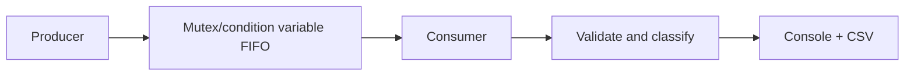

# VitalWatch — 5-minute recruiter / interviewer demo

> Educational C++17 simulator; synthetic data only; **not** a medical device or clinical system.

## Before the demo

Build once in a local terminal. Linux commands below assume a C++17 compiler and CMake 3.16+; use the Visual Studio 2022 configuration in the root README on Windows. Windows/MSVC has not yet been verified in the provided evidence.

```bash
cmake -S . -B build -DCMAKE_BUILD_TYPE=Release
cmake --build build --parallel
ctest --test-dir build --output-on-failure
```

## 0:00–0:45 — The problem

"VitalWatch demonstrates how a monitoring pipeline can separate disconnected, missing or invalid sensor values from valid values that cross configurable demonstration thresholds. All readings and alerts are synthetic and non-clinical."

Show `src/`, `include/vitalwatch/` and the architecture diagram in `docs/ARCHITECTURE.md`.

## 0:45–2:00 — Run a deterministic scenario

```bash
./build/vitalwatch --deterministic --count 8 --interval-ms 0 --log-dir logs-demo
```

Point out the console table, three channels, missing/invalid/disconnected cases and demo alerts. This reproducible scenario produces **8 reading rows and 6 event rows**, as recorded in `evidence/demo-console.txt` and CSV evidence.

On Windows, the equivalent executable path is `.\build\Release\vitalwatch.exe` after a successful Release build.

## 2:00–3:00 — Explain concurrency



Explain: `std::thread` runs the two workers, a `std::mutex` protects queue state, `std::condition_variable` avoids busy polling, and `close()` allows graceful draining. Do not describe it as a real-time guarantee.

## 3:00–4:00 — Inspect output and testing

```bash
cat logs-demo/readings.csv
cat logs-demo/events.csv
ctest --test-dir build --output-on-failure
```

Show the timestamped output files and 23 CTest cases. Cite `evidence/ctest-release.txt` for **23/23 recorded passes on Linux/GCC** and `docs/VERIFICATION.md` for the exact verification conditions.

## 4:00–5:00 — Discuss failure paths and limitations

- CSV replay can reject malformed rows before worker startup.
- Worker exceptions are surfaced after shutdown and join.
- `Ctrl+C` was checked on Linux; native Windows behavior still needs independent testing.
- Mention **1,000 FIFO samples** from the `shutdown` test; this is a correctness check, **not throughput**.
- Possible next improvement: a bounded queue with backpressure and native Windows CI.

## Three questions to be ready for

**Why use C++?** It lets the project demonstrate standard threads, data ownership, STL containers and compiled component integration. A small demo does not prove C++ was needed for speed.

**How do you avoid race conditions?** Shared queue state is accessed under one mutex; producer-owned and consumer-owned objects are not concurrently mutated. Tests cover relevant scenarios but cannot exhaust every possible scheduling order.

**Why keep invalid data separate from threshold alerts?** Invalid, missing or disconnected samples are not reliable measurements. Demo threshold rules are applied only to usable values.

## Good interview summary

"I built VitalWatch as an educational C++17 simulator to practise component design and thread synchronization. Two workers communicate through a protected FIFO queue; the consumer validates readings, applies configurable demo rules, and logs the results. I verified 23 CTest cases on Linux/GCC, including 1,000 samples in FIFO order. The main lessons were reproducible debugging, thread ownership and safe shutdown—not clinical monitoring or real-device integration."
